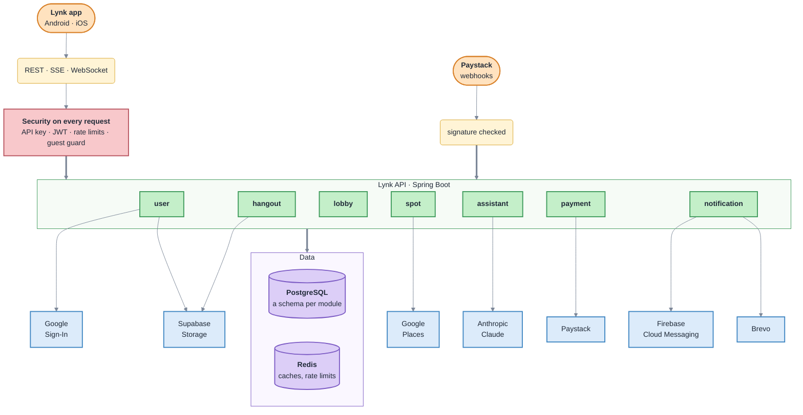
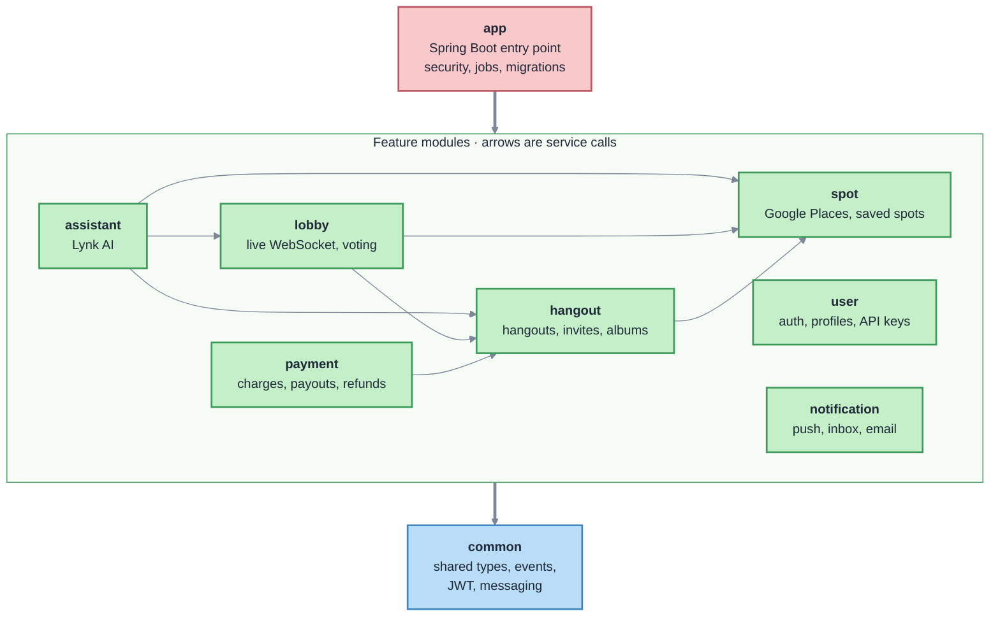
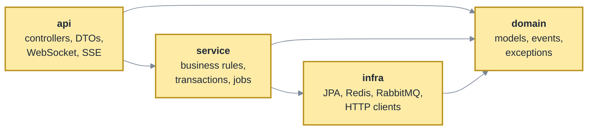
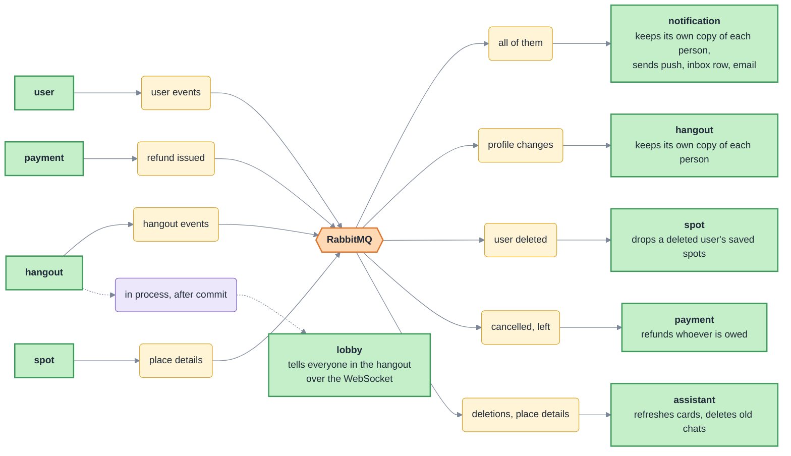
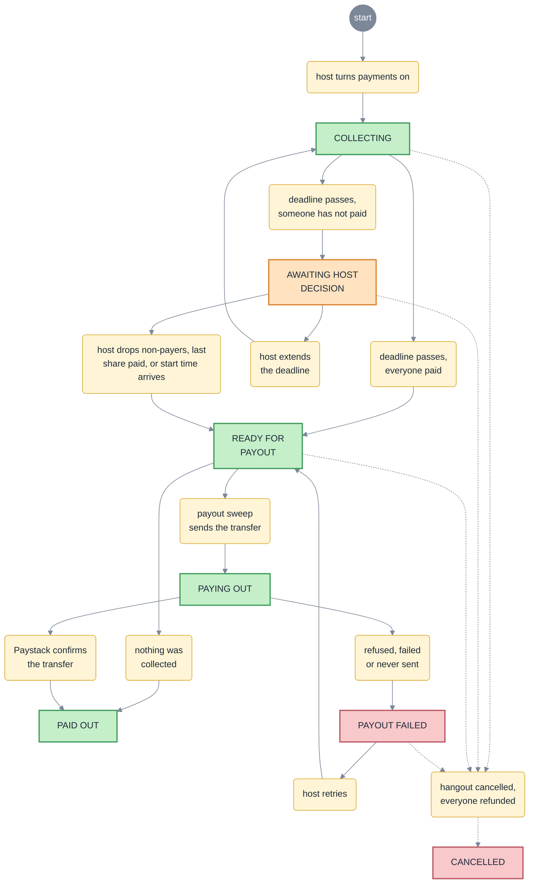
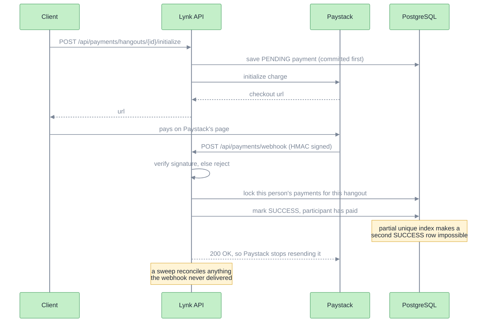
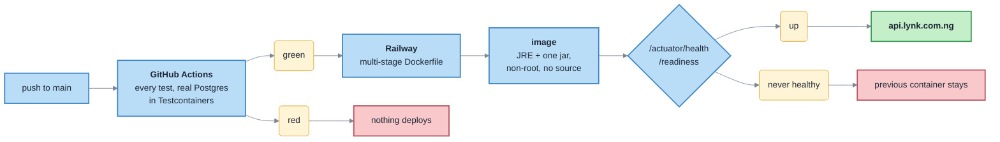

# Lynk API

Stop arguing in the group chat. Just Lynk.

Friends create a hangout, invite their squad, vote on a spot everyone can reach, split the bill, and show up. This is
the backend: a Kotlin **Spring Boot modular monolith** running in production on Railway, with a Kotlin Multiplatform
client for Android and iOS.

**Live:** https://api.lynk.com.ng · **Client:** [Lynk (KMP)](https://github.com/EEseka/Lynk) ·
**Website:** [lynk.com.ng](https://lynk.com.ng)

---

## What it does

| Feature           | What it does                                                                                                                            |
|-------------------|-----------------------------------------------------------------------------------------------------------------------------------------|
| **Auth**          | Google Sign-In and guest accounts, JWT with rotating refresh tokens, plus an API key on every request                                   |
| **Hangouts**      | Create, edit, cancel, look a friend up by username and invite them, RSVP, attendee limits where a pending invite already holds the slot |
| **Spots**         | Search, trending and a Top 10 from Google Places, sorted into hangout categories, Redis-cached, saved spots                            |
| **Lynk AI**       | Claude Sonnet as a spot helper over Server-Sent Events, searching real places with tools, for Discover and for a hangout while it votes |
| **Live lobby**    | Raw WebSockets: presence, spot proposals, live vote tallies, host tie-break                                                             |
| **Payments**      | Paystack bill-splitting: per-share charges, deadlines, host payouts, automatic refunds                                                  |
| **Albums**        | A private photo album per finished hangout, uploaded straight to Supabase Storage through signed links                                  |
| **Notifications** | Firebase push, an in-app inbox, and transactional email through Brevo                                                                   |

## Built with

<table>
  <tr>
    <td align="center" width="110"><br><b>Kotlin</b><br>2.4</td>
    <td align="center" width="110"><br><b>Spring Boot</b><br>4.0</td>
    <td align="center" width="110"><br><b>PostgreSQL</b><br>17</td>
    <td align="center" width="110"><br><b>Testcontainers</b><br>real Postgres in tests</td>
    <td align="center" width="110"><br><b>Redis</b><br>cache, limits</td>
    <td align="center" width="110"><br><b>RabbitMQ</b><br>events</td>
  </tr>
  <tr>
    <td align="center" width="110"><br><b>Flyway</b><br>migrations</td>
    <td align="center" width="110"><br><b>Claude</b><br>Lynk AI</td>
    <td align="center" width="110"><br><b>Koog</b><br>AI agent framework</td>
    <td align="center" width="110"><br><b>Google Places</b><br>spots</td>
    <td align="center" width="110"><br><b>Paystack</b><br>payments</td>
    <td align="center" width="110"><br><b>Firebase</b><br>push</td>
  </tr>
  <tr>
    <td align="center" width="110"><br><b>Supabase</b><br>database, storage</td>
    <td align="center" width="110"><br><b>Brevo</b><br>email</td>
    <td align="center" width="110"><br><b>Docker</b><br>image</td>
    <td align="center" width="110"><br><b>Railway</b><br>hosting</td>
    <td align="center" width="110"><br><b>GitHub Actions</b><br>CI</td>
    <td align="center" width="110"><br><b>Gradle</b><br>build</td>
  </tr>
</table>

## Architecture

### The system



Every request from the app passes an API key filter, then a JWT filter, then per-IP and per-user rate limits in Redis,
then a guard that refuses any write from a guest account. Paystack's webhooks go straight to `payment`, skip the
first two, and are accepted only with a valid HMAC signature.

### The modules

`app` is the only Spring Boot application. Every other Gradle module is a library that owns one slice of the domain
and its own Postgres schema. Other modules call its services and use its domain types, but never touch its
repositories or tables. The one shared piece of API is `spot`'s `SpotDto`, so a place looks the same in every
response that shows one.



Inside every module the same four layers, and dependencies only point one way:



```
app            Spring Boot entry point, security, rate limiting, scheduling, Flyway migrations
common         shared types, events, JWT, exception handling, RabbitMQ and storage plumbing
user           auth, profiles, API keys, profile photos
hangout        hangouts, participants, invites, RSVP, albums, the payment state machine
spot           Google Places integration, trending and Top 10 cache, saved spots
lobby          raw WebSocket lobby, presence, voting
payment        Paystack charges, webhooks, payouts, refunds, reconciliation
notification   FCM push, inbox rows, Thymeleaf email
assistant      Lynk AI: the Claude tool loop, chats, daily limits, SSE streaming
```

### Events between modules

Modules never read each other's tables. `hangout` learns a person exists because `user` published an event, and
keeps its own copy of what it needs. Events cross modules over RabbitMQ: `user` announces sign-ups, profile changes
and deletions; `hangout` announces invites, RSVPs, reminders, payments, photos and cancellations. Deleting an account
also cleans up everywhere: saved spots, chats, album photos, the inbox and device tokens. The live lobby hears about
changes inside the same process, once the database transaction has committed.



### The payment state machine

Every change of payment state comes from a signature-checked Paystack webhook, a host action, or a scheduled sweep
that reads the current state from the database. None comes from a message on the queue, since a queued message can
arrive twice, late, or out of order.



### How a payment actually lands

The client never tells the server that it paid. Paystack does, over a signed callback.



The `PENDING` row is committed *before* Paystack is called. If those shared a transaction, and it rolled back, Paystack
would hold a live charge against a reference this database had never heard of, and the money would arrive with nothing
to attach it to.

### Things worth a closer look

**A payment lifecycle that survives failure.** Charges are confirmed by a signature-verified Paystack webhook, never by
the client. Scheduled sweeps resolve deadlines, chase stuck payments, retry failed refunds, and reconcile payouts
against the provider. Every refund and every payout attempt is its own row, so the history of where the money went is
never overwritten. A pessimistic lock on the payer's rows, plus a partial unique index on `WHERE status = 'SUCCESS'`,
means a second payment for the same share is caught and sent back, even when two webhooks land at once.

**Concurrency handled on purpose.** The hangout row has many writers (the host, attendees, webhooks, sweeps), so it
carries an optimistic `@Version`, and every change to who is in a hangout first takes a row lock, so two people
accepting the last free share can't both get in.

**Lynk AI on real data.** The assistant is a tool loop over Claude: it searches Google Places through the `spot`
module, reads opening hours and amenities, and shows places as cards the app can open, save, or put on the ballot. It
can only recommend places its own tools returned, answers stream over Server-Sent Events, and each answer's token
usage is stored.

**Schema owned by migrations.** Flyway builds every environment from `V1__baseline.sql`; Hibernate runs `validate`
everywhere and creates nothing, including in development.

**Defence in depth.** Default-deny security, an API key filter ahead of the chain, guest accounts that cannot write,
per-IP and per-user rate limiting in Redis, and account-deletion guards that refuse to strand money mid-flight.

## Testing

The integration tests run against **real PostgreSQL in Testcontainers**, built by the same migrations production
uses. Outside services (Paystack, Google, Claude, Firebase, Brevo, Supabase Storage) are replaced with mocks, and
RabbitMQ with an in-memory broker that hands each event to the real listeners.

```
Unit                  money arithmetic, webhook signatures, opening hours, place types, Top 10 ranking
REST journeys         auth, hangouts, participants, spots, profile, albums, notifications, payments
Scheduled sweeps      every one, invoked directly, since no endpoint can reach them
Payment webhook       a signed Paystack callback driving the full state machine
Concurrency           eight people racing for the last free share
Lynk AI               a scripted stand-in for Claude driving the whole tool loop and answer stream
Email                 every template branch rendered
```

```bash
./gradlew build        # compiles and runs everything; needs Docker running
```

## Running it

Needs **JDK 21** and **Docker**.

```bash
git clone https://github.com/EEseka/lynk-api.git && cd lynk-api
cp .env.example .env       # then fill it in
./gradlew build
set -a && source .env && set +a      # load .env into this shell, Spring Boot doesn't read it on its own
SPRING_PROFILES_ACTIVE=dev ./gradlew :app:bootRun
```

API docs are served in development only, at `http://localhost:8080/swagger-ui/index.html`. They are switched off in
production, so the API surface isn't published.

### Configuration

`application.yaml` holds everything shared, `application-dev.yaml` and `application-prod.yaml` hold what differs, and
every secret arrives from the environment. Nothing sensitive is in the repository. For push notifications locally,
you can skip `FIREBASE_CREDENTIALS_JSON` and put the service account file at
`app/src/main/resources/firebase-credentials/lynk-firebase-adminsdk.json` instead, which git ignores.

| Variables                                              | Used for                                         |
|--------------------------------------------------------|--------------------------------------------------|
| `POSTGRES_PASSWORD` `DATABASE_URL` `DATABASE_USERNAME` | Postgres                                         |
| `SUPABASE_SERVICE_KEY`                                 | profile photo and album storage                  |
| `REDIS_PASSWORD` `RABBITMQ_PASSWORD`                   | cache and message queue                          |
| `JWT_SECRET_BASE64` `ADMIN_USERNAME` `ADMIN_PASSWORD`  | auth                                             |
| `GOOGLE_CLIENT_ID` `GOOGLE_PLACES_KEY`                 | Google Sign-In and Places                        |
| `PAYSTACK_SECRET_KEY`                                  | payments                                         |
| `BREVO_API_KEY`                                        | email, over Brevo's HTTP API                     |
| `ANTHROPIC_API_KEY`                                    | Lynk AI                                          |
| `ASSISTANT_DISABLED`                                   | optional; `true` switches Lynk AI off            |
| `FIREBASE_CREDENTIALS_JSON`                            | push notifications, the service account JSON     |

## Deployment



Push to `main` → GitHub Actions runs every test → Railway builds the multi-stage Dockerfile and deploys only if they
passed. The runtime image carries a JRE and one jar: no compiler, no source, no credentials, and it runs as an
unprivileged user.

Railway moves traffic to a new deployment only once `/actuator/health/readiness` answers, rather than the full health
endpoint, so a Redis or RabbitMQ blip can't hold up a deployment that is otherwise ready.

## Status

Backend feature-complete and deployed. The [KMP client](https://github.com/EEseka/Lynk) is out on Android: download the
APK from [lynk.com.ng](https://lynk.com.ng). The App Store and Google Play releases come next.

Payments are built and tested end to end against Paystack's test mode, but they do not take real money. Holding
attendees' money until the payment deadline counts as a regulated activity in Nigeria, and the licence it needs from
the Central Bank is out of reach for a solo developer.

## License

All rights reserved. The code is public to read, but not licensed for use. See [LICENSE](LICENSE).
